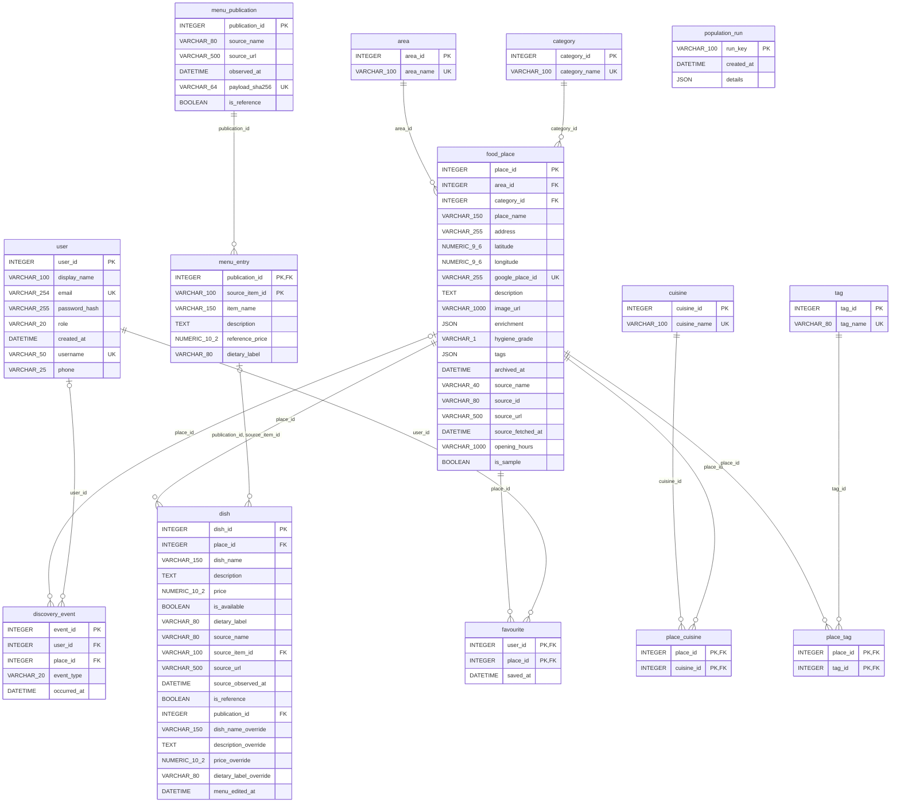
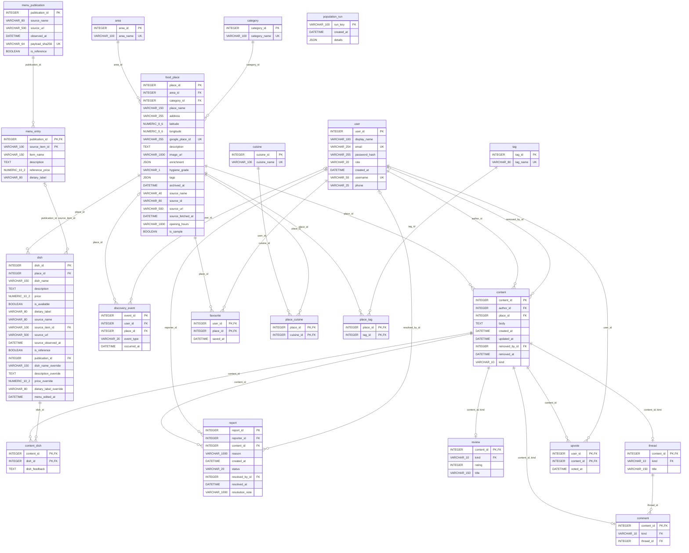
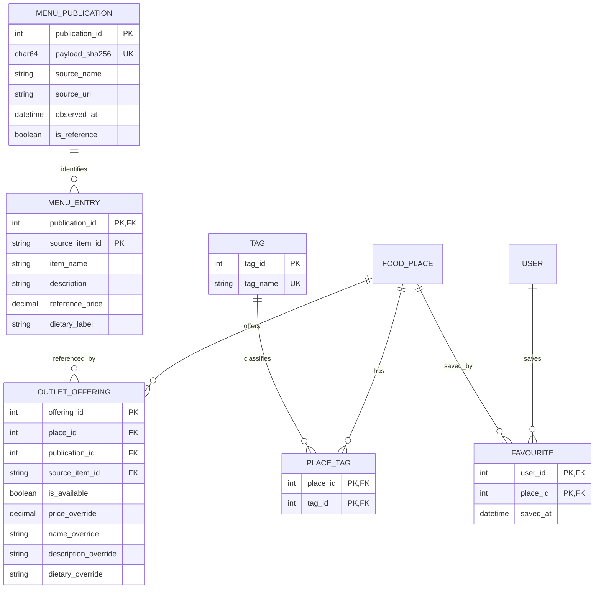

# Makan Where relational design reference

**27 October dish-selection correction:** shared `menu_entry.reference_price` permits `NULL` when the published source supplies an item name but no price. The same outlet `dish_id` can then be selected in review feedback. `NULL` remains distinct from a known zero-price override; affordability queries exclude unknown prices. The offline, repeatable `import-menu-highlights` command populates retained, attributed names and preserves existing outlet identities, manual edits and unavailable rows. Earlier proposal text below remains historical.

The current code declares **21 SQL tables and 115 columns**: fourteen active tables and seven retained community migration tables. The dish table preserves outlet identities and stores overrides; menu_publication/menu_entry hold shared facts. Live community content is in MongoDB. This describes source declarations, not a live deployment inspection.

Regenerate with `.venv/Scripts/python scripts/export_database_model.py`. Canonical sources: `backend/models.py`, `backend/mongo.py`, `backend/community.py`, `backend/community_migration.py`, `backend/population.py` and `backend/database_lab.py`.

The [schema diagram PDF](assets/database-model-full.pdf) records the earlier 87-column model, before dish provenance and listing enrichment were added. The current generated diagrams and dictionary below include those fields. The cloud report is not changed by this exporter.

## Active relational model

Every active table and declared attribute appears below. PK = primary key; FK = foreign key; UK = single-column unique. Composite unique constraints and checks are listed in the dictionary. Each child has exactly one parent unless its FK is nullable; each parent can have zero or many child rows. Population receipts have no foreign key.



## Retained migration model

The following complete physical SQL ERD also includes the seven legacy tables: `content`, `review`, `thread`, `comment`, `content_dish`, `upvote` and `report`. They remain migration inputs, not the live community store. Subtype tables reference `(content_id, kind)`; a content row can have zero or one of each subtype at the SQL constraint level. Application logic creates a valid subtype.



## SQL data dictionary

### area

Role: live.

| Column | Declared type | Nullable | Key |
| --- | --- | --- | --- |
| `area_id` | `INTEGER` | No | PK |
| `area_name` | `VARCHAR(100)` | No | UQ |

- UNIQUE `(area_name)`.

### category

Role: live.

| Column | Declared type | Nullable | Key |
| --- | --- | --- | --- |
| `category_id` | `INTEGER` | No | PK |
| `category_name` | `VARCHAR(100)` | No | UQ |

- UNIQUE `(category_name)`.

### cuisine

Role: live.

| Column | Declared type | Nullable | Key |
| --- | --- | --- | --- |
| `cuisine_id` | `INTEGER` | No | PK |
| `cuisine_name` | `VARCHAR(100)` | No | UQ |

- UNIQUE `(cuisine_name)`.

### menu_publication

Role: live.

| Column | Declared type | Nullable | Key |
| --- | --- | --- | --- |
| `publication_id` | `INTEGER` | No | PK |
| `source_name` | `VARCHAR(80)` | No | — |
| `source_url` | `VARCHAR(500)` | No | — |
| `observed_at` | `DATETIME` | No | — |
| `payload_sha256` | `VARCHAR(64)` | No | UQ |
| `is_reference` | `BOOLEAN` | No | — |

- UNIQUE `(payload_sha256)`.

### population_run

Role: live.

| Column | Declared type | Nullable | Key |
| --- | --- | --- | --- |
| `run_key` | `VARCHAR(100)` | No | PK |
| `created_at` | `DATETIME` | No | — |
| `details` | `JSON` | No | — |


### tag

Role: live.

| Column | Declared type | Nullable | Key |
| --- | --- | --- | --- |
| `tag_id` | `INTEGER` | No | PK |
| `tag_name` | `VARCHAR(80)` | No | UQ |

- UNIQUE `(tag_name)`.

### user

Role: live.

| Column | Declared type | Nullable | Key |
| --- | --- | --- | --- |
| `user_id` | `INTEGER` | No | PK |
| `display_name` | `VARCHAR(100)` | No | — |
| `email` | `VARCHAR(254)` | No | UQ |
| `password_hash` | `VARCHAR(255)` | No | — |
| `role` | `VARCHAR(20)` | No | — |
| `created_at` | `DATETIME` | No | — |
| `username` | `VARCHAR(50)` | No | UQ |
| `phone` | `VARCHAR(25)` | No | — |

- UNIQUE `(email)`.
- UNIQUE `(username)`.
- CHECK `role IN ('user', 'admin')`.

### food_place

Role: live.

| Column | Declared type | Nullable | Key |
| --- | --- | --- | --- |
| `place_id` | `INTEGER` | No | PK |
| `area_id` | `INTEGER` | No | FK |
| `category_id` | `INTEGER` | No | FK |
| `place_name` | `VARCHAR(150)` | No | — |
| `address` | `VARCHAR(255)` | No | — |
| `latitude` | `NUMERIC(9, 6)` | Yes | — |
| `longitude` | `NUMERIC(9, 6)` | Yes | — |
| `google_place_id` | `VARCHAR(255)` | Yes | UQ |
| `description` | `TEXT` | No | — |
| `image_url` | `VARCHAR(1000)` | No | — |
| `enrichment` | `JSON` | Yes | — |
| `hygiene_grade` | `VARCHAR(1)` | Yes | — |
| `tags` | `JSON` | No | — |
| `archived_at` | `DATETIME` | Yes | — |
| `source_name` | `VARCHAR(40)` | Yes | — |
| `source_id` | `VARCHAR(80)` | Yes | — |
| `source_url` | `VARCHAR(500)` | Yes | — |
| `source_fetched_at` | `DATETIME` | Yes | — |
| `opening_hours` | `VARCHAR(1000)` | Yes | — |
| `is_sample` | `BOOLEAN` | No | — |

- FK `(area_id)` → `area(area_id)`.
- FK `(category_id)` → `category(category_id)`.
- UNIQUE `(google_place_id)`.
- UNIQUE `(source_name, source_id)`.
- CHECK `hygiene_grade IS NULL OR hygiene_grade IN ('A','B','C','D')`.
- CHECK `latitude IS NULL OR latitude BETWEEN -90 AND 90`.
- CHECK `longitude IS NULL OR longitude BETWEEN -180 AND 180`.
- Index `ix_food_place_area_id` on `(area_id)`.
- Index `ix_food_place_place_name` on `(place_name)`.

### menu_entry

Role: live.

| Column | Declared type | Nullable | Key |
| --- | --- | --- | --- |
| `publication_id` | `INTEGER` | No | PK, FK |
| `source_item_id` | `VARCHAR(100)` | No | PK |
| `item_name` | `VARCHAR(150)` | No | — |
| `description` | `TEXT` | No | — |
| `reference_price` | `NUMERIC(10, 2)` | Yes | — |
| `dietary_label` | `VARCHAR(80)` | No | — |

- FK `(publication_id)` → `menu_publication(publication_id)`.
- CHECK `reference_price >= 0`.

### content

Role: legacy migration source.

| Column | Declared type | Nullable | Key |
| --- | --- | --- | --- |
| `content_id` | `INTEGER` | No | PK |
| `author_id` | `INTEGER` | No | FK |
| `place_id` | `INTEGER` | No | FK |
| `body` | `TEXT` | No | — |
| `created_at` | `DATETIME` | No | — |
| `updated_at` | `DATETIME` | No | — |
| `removed_by_id` | `INTEGER` | Yes | FK |
| `removed_at` | `DATETIME` | Yes | — |
| `kind` | `VARCHAR(10)` | No | — |

- FK `(place_id)` → `food_place(place_id)`.
- FK `(author_id)` → `user(user_id)`.
- FK `(removed_by_id)` → `user(user_id)`.
- UNIQUE `(content_id, kind)`.
- CHECK `(removed_at IS NULL AND removed_by_id IS NULL) OR (removed_at IS NOT NULL AND removed_by_id IS NOT NULL)`.
- CHECK `kind IN ('review','thread','comment')`.
- Index `ix_content_author_id` on `(author_id)`.
- Index `ix_content_place_id` on `(place_id)`.

### discovery_event

Role: live.

| Column | Declared type | Nullable | Key |
| --- | --- | --- | --- |
| `event_id` | `INTEGER` | No | PK |
| `user_id` | `INTEGER` | Yes | FK |
| `place_id` | `INTEGER` | Yes | FK |
| `event_type` | `VARCHAR(20)` | No | — |
| `occurred_at` | `DATETIME` | No | — |

- FK `(place_id)` → `food_place(place_id)`.
- FK `(user_id)` → `user(user_id)`.
- CHECK `event_type != 'place_view' OR place_id IS NOT NULL`.
- CHECK `event_type IN ('search','place_view')`.
- Index `ix_discovery_event_occurred_at` on `(occurred_at)`.

### dish

Role: live.

| Column | Declared type | Nullable | Key |
| --- | --- | --- | --- |
| `dish_id` | `INTEGER` | No | PK |
| `place_id` | `INTEGER` | No | FK |
| `dish_name` | `VARCHAR(150)` | No | — |
| `description` | `TEXT` | No | — |
| `price` | `NUMERIC(10, 2)` | No | — |
| `is_available` | `BOOLEAN` | No | — |
| `dietary_label` | `VARCHAR(80)` | No | — |
| `source_name` | `VARCHAR(80)` | Yes | — |
| `source_item_id` | `VARCHAR(100)` | Yes | FK |
| `source_url` | `VARCHAR(500)` | Yes | — |
| `source_observed_at` | `DATETIME` | Yes | — |
| `is_reference` | `BOOLEAN` | No | — |
| `publication_id` | `INTEGER` | Yes | FK |
| `dish_name_override` | `VARCHAR(150)` | Yes | — |
| `description_override` | `TEXT` | Yes | — |
| `price_override` | `NUMERIC(10, 2)` | Yes | — |
| `dietary_label_override` | `VARCHAR(80)` | Yes | — |
| `menu_edited_at` | `DATETIME` | Yes | — |

- FK `(place_id)` → `food_place(place_id)`.
- FK `(publication_id, source_item_id)` → `menu_entry(publication_id, source_item_id)`.
- UNIQUE `(place_id, publication_id, source_item_id)`.
- UNIQUE `(place_id, source_name, source_item_id)`.
- CHECK `price >= 0`.
- CHECK `price_override IS NULL OR price_override >= 0`.
- CHECK `publication_id IS NULL OR (dish_name = '' AND price = 0 AND description = '' AND dietary_label = '' AND source_name IS NULL AND source_url IS NULL AND source_observed_at IS NULL)`.
- CHECK `publication_id IS NULL OR source_item_id IS NOT NULL`.
- Index `ix_dish_place_id` on `(place_id)`.

### favourite

Role: live.

| Column | Declared type | Nullable | Key |
| --- | --- | --- | --- |
| `user_id` | `INTEGER` | No | PK, FK |
| `place_id` | `INTEGER` | No | PK, FK |
| `saved_at` | `DATETIME` | No | — |

- FK `(place_id)` → `food_place(place_id)`.
- FK `(user_id)` → `user(user_id)`.

### place_cuisine

Role: live.

| Column | Declared type | Nullable | Key |
| --- | --- | --- | --- |
| `place_id` | `INTEGER` | No | PK, FK |
| `cuisine_id` | `INTEGER` | No | PK, FK |

- FK `(cuisine_id)` → `cuisine(cuisine_id)`.
- FK `(place_id)` → `food_place(place_id)`.

### place_tag

Role: live.

| Column | Declared type | Nullable | Key |
| --- | --- | --- | --- |
| `place_id` | `INTEGER` | No | PK, FK |
| `tag_id` | `INTEGER` | No | PK, FK |

- FK `(place_id)` → `food_place(place_id)`.
- FK `(tag_id)` → `tag(tag_id)`.

### content_dish

Role: legacy migration source.

| Column | Declared type | Nullable | Key |
| --- | --- | --- | --- |
| `content_id` | `INTEGER` | No | PK, FK |
| `dish_id` | `INTEGER` | No | PK, FK |
| `dish_feedback` | `TEXT` | Yes | — |

- FK `(content_id)` → `content(content_id)`.
- FK `(dish_id)` → `dish(dish_id)`.

### report

Role: legacy migration source.

| Column | Declared type | Nullable | Key |
| --- | --- | --- | --- |
| `report_id` | `INTEGER` | No | PK |
| `reporter_id` | `INTEGER` | No | FK |
| `content_id` | `INTEGER` | No | FK |
| `reason` | `VARCHAR(1000)` | No | — |
| `created_at` | `DATETIME` | No | — |
| `status` | `VARCHAR(20)` | No | — |
| `resolved_by_id` | `INTEGER` | Yes | FK |
| `resolved_at` | `DATETIME` | Yes | — |
| `resolution_note` | `VARCHAR(1000)` | Yes | — |

- FK `(content_id)` → `content(content_id)`.
- FK `(reporter_id)` → `user(user_id)`.
- FK `(resolved_by_id)` → `user(user_id)`.
- CHECK `status IN ('open','resolved','dismissed')`.
- Index `ix_report_content_id` on `(content_id)`.

### review

Role: legacy migration source.

| Column | Declared type | Nullable | Key |
| --- | --- | --- | --- |
| `content_id` | `INTEGER` | No | PK, FK |
| `kind` | `VARCHAR(10)` | No | FK |
| `rating` | `INTEGER` | No | — |
| `title` | `VARCHAR(150)` | No | — |

- FK `(content_id, kind)` → `content(content_id, kind)`.
- CHECK `kind = 'review'`.
- CHECK `rating BETWEEN 1 AND 5`.

### thread

Role: legacy migration source.

| Column | Declared type | Nullable | Key |
| --- | --- | --- | --- |
| `content_id` | `INTEGER` | No | PK, FK |
| `kind` | `VARCHAR(10)` | No | FK |
| `title` | `VARCHAR(150)` | No | — |

- FK `(content_id, kind)` → `content(content_id, kind)`.
- CHECK `kind = 'thread'`.

### upvote

Role: legacy migration source.

| Column | Declared type | Nullable | Key |
| --- | --- | --- | --- |
| `user_id` | `INTEGER` | No | PK, FK |
| `content_id` | `INTEGER` | No | PK, FK |
| `voted_at` | `DATETIME` | No | — |

- FK `(content_id)` → `content(content_id)`.
- FK `(user_id)` → `user(user_id)`.

### comment

Role: legacy migration source.

| Column | Declared type | Nullable | Key |
| --- | --- | --- | --- |
| `content_id` | `INTEGER` | No | PK, FK |
| `kind` | `VARCHAR(10)` | No | FK |
| `thread_id` | `INTEGER` | No | FK |

- FK `(content_id, kind)` → `content(content_id, kind)`.
- FK `(thread_id)` → `thread(content_id)`.
- CHECK `kind = 'comment'`.
- Index `ix_comment_thread_id` on `(thread_id)`.

## Derived view

`catalogue_menu_summary` is a view, not another stored table. It joins active venues to available dishes and derives available dish count, starting price and average price.

```sql
SELECT p.place_id, p.place_name, COUNT(d.dish_id) AS available_dishes,
MIN(d.price) AS starting_price, AVG(d.price) AS average_price
FROM food_place p LEFT JOIN catalogue_effective_menu d ON d.place_id = p.place_id AND d.is_available = 1
WHERE p.archived_at IS NULL GROUP BY p.place_id, p.place_name
```

## MongoDB model

Five collections are used: three community collections and two operational collections. References across SQL/MongoDB are checked by the API and audits; they are not database foreign keys or a distributed transaction.

| Collection | Stored fields and relationships | Constraints / responsibility |
| --- | --- | --- |
| `content` | Integer `_id`, `kind`, `author_id`, `place_id`, `body`, created/updated/removed timestamps, `removed_by_id`, `is_demo`; embedded `dishes[{dish_id, feedback}]`. Reviews add `title` and `rating`; threads add `title`; comments add `thread_id` pointing to a thread in this same collection. | JSON Schema validates subtype requirements, rating 1–5 and ≤20 embedded dish entries. API checks author/place/dish existence, unique dishes and same-venue thread/dishes. |
| `upvotes` | ObjectId `_id`, `user_id`, `content_id`, `voted_at`; seeded votes also carry `is_demo`. | UNIQUE `(user_id, content_id)`; SQL user and Mongo content are application references. |
| `reports` | Integer `_id`, `reporter_id`, `content_id`, `reason`, `status`, `created_at`; resolution adds `resolved_by_id`, `resolved_at`, `resolution_note`. | Schema checks required fields and status (`open`, `resolved`, `dismissed`); conditional resolution updates only open reports. Resolution fields are written by the API but are not declared in the report validator. |
| `counters` | String `_id` (namespace), numeric `value`. | Atomic increment for content/report IDs; no JSON Schema validator configured. |
| `population_runs` | ObjectId `_id`, `completed_at`, `summary` (version, counts before/after/added, CSV hash and completion time). | Audit receipts for completed seed runs; no JSON Schema validator configured. |

Seeded content/reports use a string `seed_key` with a partial unique index. Migrated documents carry `legacy_checksum`. These metadata fields are written by population/migration code; the validators allow additional properties. Other indexes: content `(place_id, removed_at, kind, _id)` and `(thread_id, removed_at)`; upvotes `(content_id)`; reports `(status, created_at)`.

Mutable author/dish names remain in SQL and are resolved in batches when serializing MongoDB content. Feedback is embedded for a bounded atomic update; unbounded replies, votes and reports are referenced. Soft removal retains identities. The complete validators are preserved in `docs/assets/database-model.json`.

---

## Revised design using the Week 1 to 5 concepts

**Status: executable design proposal, validated in isolation on 6 October 2026.** The original design above and the deployed application are retained. This section changes the proposed logical model; it is not a claim that the server has been migrated. Its [MariaDB DDL](../database/design_v2_mariadb.sql), [SQLAlchemy definition](../database/design_v2.py) and [validation results](evidence/design-v2-validation.json) make the proposal inspectable.

### 1. Requirements before tables

The catalogue must distinguish three different facts: what a source published, what that publication says about an item, and what a particular outlet offers. An outlet can use a shared reference menu while retaining its own availability and explicitly recorded overrides. A newer publication must not erase the old source observation. Existing review-to-dish references must keep their identities.

These requirements give the following rules:

1. A menu publication is one identified source observation. Its source URL, observation time and reference status belong to that publication. A fingerprint of its canonical payload is an alternate unique identity for detecting an exact repeat.
2. An item is identified **within a publication** by its `source_item_id`. That value alone is not globally unique.
3. An outlet offering connects one venue to one publication entry. Availability and outlet overrides belong to this relationship. One outlet has at most one offering for a particular publication entry.
4. A venue can have zero or many tags. Each membership is a separate relationship tuple.
5. Reviews, threads and replies share a content identity but have disjoint subtype requirements. Cross-database references are application-enforced and audited.

The fixed currency of this application is SGD. It is part of the price domain, so this proposal does not repeat a constant currency field in every publication. Supporting multiple currencies later would require a revised requirement and price-comparison policy.

### 2. The actual redundancy being removed

The retained reference imports contain 97 KFC entries attached to 72 outlets and eight Suki-Ya entries attached to four outlets. The current representation therefore stores **7,016 copies of item payloads** for **105 source entries**. These are chain reference prices, not verified prices at each outlet. The 18 separate sample dishes are outside this prototype's reconstruction workload.

| Current representation | Revised representation | Database concept |
| --- | --- | --- |
| Source name, URL and observation time repeated in each dish row | One `menu_publication` row per source observation | Separate facts determined by publication identity |
| Shared names, descriptions and reference prices copied into outlet dish rows | One `menu_entry` row per publication/item pair | Remove partial/transitive dependencies from the combined relation |
| Source facts and outlet edits share the same row | `outlet_offering` stores only the association, availability and explicit overrides | Relationship attributes; separate determinants |
| Venue tags stored as a JSON array in SQL | `tag` and `place_tag` | Flat relations and a many-to-many relationship |
| A dish's stored price can look like an outlet-confirmed observation | Reference price is separate from a nullable outlet override | Correct semantics for unknown versus known values |

This is not a claim that every original `dish` row violates BCNF. Manual dishes and independently edited outlet dishes do not necessarily obey a global source-item dependency. The revised requirements explicitly separate **shared source facts** from **local override facts**, which makes their dependencies clear.

An insertion anomaly occurs when a published menu cannot be stored until an outlet-specific dish row is created. An update anomaly occurs if one copied reference price is corrected but the other copies are not. A deletion anomaly occurs if deleting the last outlet copy also loses the only retained source observation. The proposed relations let publications and entries exist without an outlet and retain source observations independently of outlet availability.

### 3. Conceptual ER design and participation



`menu_entry` is a **weak entity** in this design: `source_item_id` is its partial key and the publication supplies the rest of its identity. Its participation in the identifying publication relationship is total. Merely having a foreign key would not make it weak; identification dependence is the reason here.

Every offering participates in exactly one venue relationship and exactly one entry relationship. Venues and entries have partial participation: each may have no offerings. `outlet_offering` is an associative entity with relationship attributes. It retains a surrogate `offering_id` for external references and has an alternate composite key `(place_id, publication_id, source_item_id)`.

Publication-to-entry is one-to-many, with total participation on the entry side. The database permits an empty publication while it is staged. Requiring at least one entry before publishing is a transaction-level rule; a foreign key alone does not enforce that minimum on the parent side.

Existing area/category relationships, the cuisine junction, account keys and favourites remain. Extra ISA or ternary relations are not introduced merely to increase diagram complexity.

### 4. Functional dependencies and candidate keys

Let **Q** mean publication ID, **H** payload fingerprint, **I** source item ID, **P** venue ID and **O** offering ID. Let PublicationFacts, EntryFacts and OutletFacts denote the remaining attributes in their respective relations.

The declared business dependencies are:

```text
Q       -> H, PublicationFacts
H       -> Q
Q, I    -> EntryFacts
O       -> P, Q, I, OutletFacts
P, Q, I -> O
```

| Relation | Candidate keys | Why smaller sets are insufficient |
| --- | --- | --- |
| `menu_publication` | `{publication_id}`; `{payload_sha256}` | Each is individually unique and non-null; URL alone can have many observations |
| `menu_entry` | `{publication_id, source_item_id}` | Item ID is local to a publication; publication ID alone identifies many items |
| `outlet_offering` | `{offering_id}`; `{place_id, publication_id, source_item_id}` | The same entry can be used at many outlets, and an outlet can have many entries |
| `tag` | `{tag_id}`; `{tag_name}` | Both are individually unique and non-null |
| `place_tag` | `{place_id, tag_id}` | A venue can have several tags and a tag can classify several venues |
| Existing `favourite` | `{user_id, place_id}` | Neither a user nor a venue identifies one save on its own |

In the combined, undecomposed menu relation, `Q+` reaches publication facts but not the venue or offering, so Q is not a superkey. Nevertheless Q determines non-key publication facts: that is a BCNF violation. Similarly, `{Q,I}+` reaches entry and publication facts but not an outlet offering, so repeating those facts in every offering creates a second violation.

`O+` first reaches P, Q, I and outlet facts; Q then adds publication facts, and QI adds entry facts. It reaches the whole combined relation. `{P,Q,I}+` obtains O and then the same closure. Removing any component of that composite key loses the ability to identify an offering under these FDs. These are semantic assumptions about legal states, not dependencies inferred from coincidentally equal seed values.

### 5. Normalisation and proof of decomposition

**1NF:** cuisine and tag memberships use separate junction tuples rather than lists inside SQL cells. The proposed menu relations contain scalar values. This does not retroactively make the current JSON enrichment or operational receipts flat relations, and relational normal forms are not being claimed for Mongo documents.

**2NF:** using `{P,Q,I}` as a candidate key for the combined relation exposes entry facts dependent on the proper subset `{Q,I}` and publication facts on `{Q}`. They are moved to the relations identified by those determinants. Adding a surrogate O does not remove those other dependencies or eliminate the need to analyse alternate candidate keys.

**3NF and BCNF:** after decomposition, every nontrivial dependency in the declared projected closure has a superkey on its left. Publication Q and H are keys; entry QI is a key; offering O and PQI are keys. The verifier checks projected F+, including implied dependencies, for the actual attributes in all three menu relations. It reports no BCNF violations under the stated FD set. Since BCNF holds under those assumptions, 3NF also holds. Optional override values have their declared unknown/absent semantics; SQL NULL behaviour must still be considered separately from textbook relational proofs.

**Lossless join, first split:** separate Publication(Q, H, PublicationFacts). Its intersection with the remaining relation is Q, and Q determines the entire Publication relation. The binary lossless-join condition holds.

**Lossless join, second split:** separate Entry(Q, I, EntryFacts) from Offering(O, P, Q, I, OutletFacts). Their intersection is QI, and QI determines the entire Entry relation. This split is also lossless. Composing the two lossless steps reconstructs the combined relation without spurious tuples for legal instances. Having common columns alone would not prove this.

**Dependency preservation:** Q→publication facts and H→Q are enforceable in Publication; QI→entry facts in Entry; O→offering facts and PQI→O in Offering. The union of projected dependencies therefore derives every original declared FD. The verifier computes this separately from losslessness because BCNF decomposition does not always preserve dependencies.

These proofs concern the proposed menu submodel. They do not claim that every physical table, every unrecorded business rule or the entire deployed schema is BCNF.

### 6. Integrity constraints and query behaviour

The proposed DDL enforces non-null identifiers, publication fingerprint uniqueness, composite entry identity, composite offering uniqueness, parent references, Boolean domains and non-negative prices. The **composite foreign key** from Offering(Q,I) to Entry(Q,I) prevents an item from one publication being paired with another publication ID. Checking those two columns independently would not establish that they identify the same entry.

`ON DELETE RESTRICT` protects referenced publications, entries and venues. Outlet availability is changed without physically removing the offering identity. A migration should retain each existing `dish_id` as `offering_id`; Mongo feedback references therefore retain their numeric identities. This preserves identity, not a historical snapshot of whatever name/price was displayed when the review was written.

The effective menu is reconstructed by joins:

```sql
SELECT o.offering_id AS dish_id, o.place_id,
       COALESCE(o.name_override, e.item_name) AS dish_name,
       COALESCE(o.price_override, e.reference_price) AS effective_price,
       o.is_available, p.is_reference
FROM outlet_offering AS o
JOIN menu_entry AS e
  ON e.publication_id = o.publication_id
 AND e.source_item_id = o.source_item_id
JOIN menu_publication AS p
  ON p.publication_id = e.publication_id
WHERE o.place_id = :place_id AND o.is_available = 1
ORDER BY o.offering_id;
```

An absent override is NULL and uses the source value; a zero override is a known zero price and must remain zero. An empty description override can deliberately clear a description. These meanings must not be collapsed by truthiness checks. A reference-derived effective price keeps its reference label.

In relational algebra, this is a selection of active offerings for the requested venue, joined to Entry on QI and Publication on Q, followed by projection of the display attributes. Selection can be pushed into Offering before the inner joins. The proposed `(place_id, is_available, offering_id)` index supports that filter and order; entry/publication keys support the joins. Extra joins and indexes have costs, so reduced redundancy is not a measured speed claim.

To find outlets without available items, use `NOT EXISTS` over their offerings. A summary view should use a LEFT JOIN and `COUNT(offering_id)` to preserve zero-item outlets. Review, favourite and menu aggregates must each be computed at venue grain before combining, preventing join multiplication.

### 7. MongoDB design linked to the ER model

The live content model already has a useful **total, disjoint specialisation**: every Content is exactly one Review, Thread or Comment. The `kind` enum makes the set covering; the JSON Schema `oneOf` branches enforce subtype-specific shapes. A review has rating/title, a thread has a title, and a comment references a thread. The prototype verifies that an unknown kind and a thread carrying review fields are rejected by MongoDB.

Bounded dish feedback stays embedded in Content so the post and up to 20 feedback entries can be changed atomically. Unbounded replies and votes remain separate documents. A vote is a User–Content relationship with a unique pair; a reply is a self-reference into Content whose parent must have the Thread subtype. Parent subtype, matching venue and SQL reference existence require application checks; JSON Schema cannot enforce cross-document or cross-engine foreign keys.

MongoDB is used for the community document aggregate, while SQL enforces shared catalogue relationships. BCNF is a relational design criterion; avoiding SQL duplication does not mean all useful document embedding must be removed. The NoSQL boundary must still state its consistency and recovery rules explicitly.

### 8. Executable evidence and safe migration path

Run `.venv/Scripts/python.exe scripts/verify_design_v2.py --env .env.demo`. The runner creates an in-memory SQLite prototype and a uniquely named disposable Mongo database. It does not connect to or alter the live application database. It generates the MariaDB DDL as an output; MariaDB execution is not claimed by this run.

The recorded **19 checks passed** on SQLite 3.50.4 and MongoDB 8.0.19. They cover:

- Formal BCNF, both lossless splits and dependency preservation.
- Exact reconstruction of **7,016 offering rows from 105 shared entries and two publications** before adding a newer test publication; no missing or spurious rows.
- An outlet-only zero-price/name override, and a newer observation that retains old entries, stable offering IDs and the override.
- Database rejection of missing parents, mismatched composite references, duplicate offerings, negative overrides, deleting a referenced publication, duplicate tag memberships and duplicate publication fingerprints.
- Mongo covering/disjoint subtype rules, the feedback bound and vote-pair uniqueness.

The proposed update procedure creates a new publication and its entries, checks the selected outlets, and retargets the existing offering rows in one SQL transaction. It must preserve overrides/unavailable rows and match entries by their source identity. Missing, renamed or conflicting source identities need explicit review rather than silent reassignment. The composite uniqueness rule is per outlet/publication/entry; it does not, by itself, prohibit every possible duplicate logical item across different publications. Selecting the current edition and preventing overlapping active replacements remains a guarded import-operation rule.

Before a live migration: back up both databases; build a preview grouped by actual source observation and payload; isolate conflicts or manual edits; create/backfill the new tables with stable IDs; compare complete old/new result multisets; verify Mongo references and admin editing; run the target MariaDB suite; then switch reads/writes together. Retain the old dish/tag representation as a read-only migration snapshot, not a second independently writable source. The isolated prototype proves the proposed relationships and examples, not that this migration has already been written or executed.

### Lecture links and scope

This design uses **Lecture 2** participation/cardinality (p. 12), weak entities (p. 16) and entity/relationship choices (p. 18); **Lecture 4** closure and candidate keys (pp. 15–19), 1NF (p. 22), BCNF/decomposition (pp. 23–28), and losslessness versus dependency preservation (pp. 29–35). Lecture 3's joins, aggregation and NULL semantics explain the queries; Lecture 5's algebra and access paths explain the proposed indexes. The local course sources are `INF2003 Lec02.pdf`, `INF2003 Lec04.pdf` and the Week 1–5 references in [course alignment](course_alignment.md). Examples use project entities rather than disconnected textbook tables.
