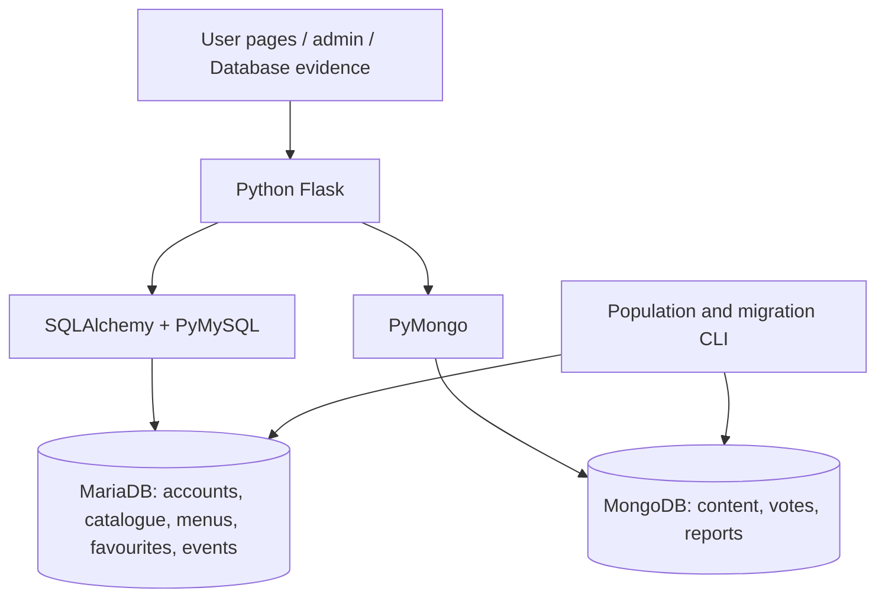
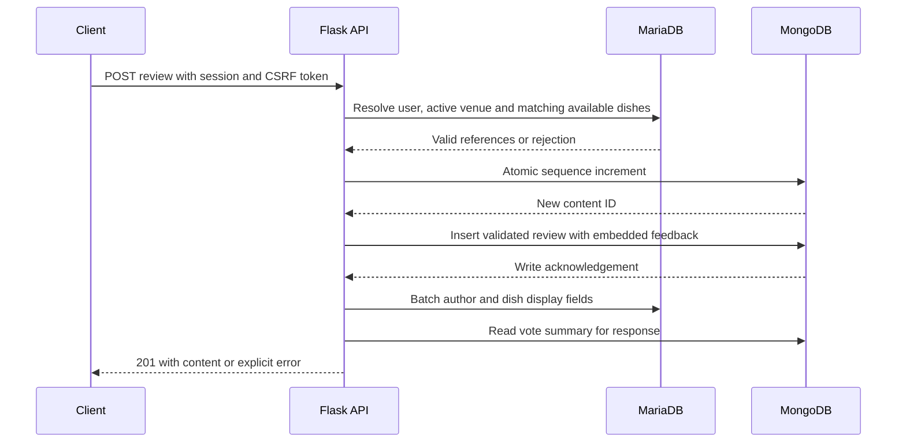

# Current system architecture

Flask serves the same-origin frontend/API. SQLAlchemy/PyMySQL target MariaDB; SQLite is an explicit local/test preview. PyMongo implements the required community storage. There is no SQL fallback when MongoDB fails.

All database reads and writes are implemented in the Python backend; see the [database code map](database_code_map.md). The application does not use a DBStudios database API, editor, session or SDK. On the live server, both drivers connect to local Unix sockets under the dedicated application identity. Shared host SSH/tunnel names in deployment scripts are hosting infrastructure, not the database access layer. The **Database evidence** page is this application's own frontend for fixed backend queries and constraint demonstrations.

## Responsibilities

Ten active SQL tables: area, category, cuisine, place_cuisine, food_place, dish, user, favourite, discovery_event and population_run. `catalogue_menu_summary` is a derived view. Lookup/junction tables normalize shared catalogue facts. Favourites use a composite PK; prices use decimals; absent menu prices remain NULL.

Menu imports add source name/item identity, source URL/time and a chain-reference flag to `dish`. A composite unique source identity prevents repeated imports at the same venue. Browser imports use administrator sessions and CSRF; two narrowly scoped integration routes accept a server-held bearer key. Preview signatures bind the source payload, venue/menu snapshot and actor for 15 minutes. New dishes and a receipt in `population_run` commit together in SQL. Existing dishes, including edited/removed records, are preserved. Reference menus remain visibly distinct from outlet-confirmed data.

Seven legacy SQL community tables (content, review, thread, comment, content_dish, upvote, report) remain as a migration source. Live community routes no longer use them. The [relational design reference](relational_design.md) is generated from the current code and includes all 17 physical SQL tables, with active and legacy roles distinguished. The [schema PDF](assets/database-model-full.pdf) shows the earlier 87-column snapshot and five MongoDB collections; use the generated dictionary for the five newer dish provenance fields. The older `docs/assets/system_architecture.svg` predates the migration; the diagram above and studio metadata describe the live design.

| Mongo collection | Structure / role | Enforcement |
| --- | --- | --- |
| content | Integer ID, kind, author/place references, body, timestamps, soft removal, bounded dish feedback; subtype-specific title/rating/thread_id | Strict JSON Schema, disjoint subtype requirements, rating 1–5, at most 20 dish links; ID/seed uniqueness, place-feed and thread indexes |
| upvotes | SQL user + Mongo content + timestamp | Compound unique pair, required field types, content index |
| reports | Reporter/content, reason, status and resolution | Required fields/types, status enum, moderation queue index and seed uniqueness |
| counters | Atomic sequence per namespace | Single-document increment; gaps are permitted |
| population_runs | Completed population summaries | Recorded evidence, not business analytics |

Mongo content IDs preserve the existing numeric API contract. Bounded feedback is embedded for atomic writes; independently growing replies/votes/reports remain separate. Mutable author/dish names are resolved from SQL in batches rather than copied into every post.

A venue request combines SQL catalogue/menu/favourite results with a Mongo rating aggregation by venue ID. Content creation validates SQL user/place/dish references and the Mongo parent before inserting one document. The feed uses seek cursors with 100-item pages and hides archived places/removed parent threads. Separate aggregates avoid join multiplication. Choosing these models does not itself prove a performance advantage.

## Consistency and failures

SQL has foreign keys within SQL. Cross-engine references are checked by Python; MongoDB cannot enforce a FK into MariaDB. The API retains identities through soft deletion. The studio audit detects privileged out-of-band orphans and mismatched references. Concurrent archive/removal after validation is possible; subsequent public reads hide the affected content. No distributed ACID transaction is claimed.

Content and feedback are atomic as one Mongo document. Votes use unique upserts. Report resolution conditionally updates only an open report, preventing a second resolution from overwriting it. SQL imports are transactional. SQL-generated activity and its receipt commit together; Mongo fixtures have stable unique keys, enabling retry after partial failure. Only one migration/seeder should run at a time, with the app stopped. Migration preserves SQL and rejects destination ID conflicts.

Outages return HTTP 503 instead of false empty success. The lab only exposes fixed evidence operations. Real password hashes, peppers and connection URLs are not returned.

## Passwords and sessions

New passwords are HMAC-SHA256 prehashed using the environment PASSWORD_PEPPER, then salted with Werkzeug scrypt (`N=32768, r=8, p=3`). The versioned envelope supports upgrading legacy Werkzeug hashes on successful login. Keep the pepper outside the database and repository; losing/rotating it requires a controlled reset strategy. The work factor is one of [OWASP's documented configurations](https://cheatsheetseries.owasp.org/cheatsheets/Password_Storage_Cheat_Sheet.html).

Signed sessions resolve live SQL roles. Mutations require CSRF. The lab password exercise uses a public dummy password and throwaway pepper. Local HTTP disables secure cookies only in local configuration; production HTTPS must enable them and use appropriate secret/rate-limit management.

---

## Database design and evaluation addendum — 6 October 2026

The original write-up above is retained. This addition focuses on the lecturer's feedback: correctness, MongoDB operations, cross-database behaviour, concurrency/recovery and controlled benchmarks. The cloud report remains unchanged.

### Data ownership and design choices

| Decision | Requirement served | Cost or boundary |
| --- | --- | --- |
| Users, venues, dishes and favourites in SQL | Stable identities, many-to-many cuisines, exact monetary values, foreign keys and composite uniqueness | Joins reconstruct a catalogue result. A venue name is not a unique identity. |
| Review/thread/comment subtypes in MongoDB | Common content fields plus subtype-specific attributes | Strict JSON Schema must reject invalid shapes; SQL references still need application checks and reconciliation. |
| At most 20 dish-feedback entries embedded per post | Save a bounded set of feedback atomically with its parent | Dish names stay in SQL. This is not an unbounded embedded menu or reply array. |
| Separate reply, vote and report documents | Independently growing sets with their own ownership, uniqueness and lifecycle | Reads need a parent lookup or aggregation; removed parents hide replies without erasing their identities. |
| Ratings and price summaries derived at read time | Changes do not leave an independently stored summary stale | Aggregation costs occur during reads, and two-engine results are not a single database snapshot. |
| Source identities and provenance retained | Idempotent imports and separation of sourced facts from examples | Same-name venues remain separate until reviewed; a matching name alone is not a deduplication rule. |

The partition is a design choice, not proof that MongoDB is universally faster than SQL. The new benchmarks isolate index effects within each engine, rather than comparing different workloads across engines.

**Price clarification:** `dish.price` is a NOT NULL, non-negative decimal. Missing menus are not inserted as zero-price dishes. Derived price fields and unpriced menu highlights may be null in the API; the earlier phrase about absent prices does not mean SQL dish rows allow null prices.

### Relational dependencies and decomposition

The catalogue uses `place_id` to determine venue attributes, including `area_id` and `category_id`. In the lookup relations, `area_id → area_name` and `category_id → category_name`; their non-null unique names also identify the corresponding lookup row. Keeping area names inside every venue would introduce `place_id → area_id → area_name`, causing a repeated-name update anomaly. Separating `area(area_id, area_name)` from the venue relation removes that dependency from the venue row. The join is lossless because the shared `area_id` is a key of `area`, and both dependencies remain enforceable in the separate relations.

`place_cuisine(place_id, cuisine_id)` represents the many-to-many association using a composite key. `favourite(user_id, place_id)` permits many saves per user and many users per venue, but one save per pair; that pair determines `saved_at`. `dish_id` determines one menu item's attributes, while a dish name can repeat. The nullable source-name/source-ID pair is an import identity when present, not an unconditional candidate key for all venues. These arguments explain named decompositions; neither a surrogate primary key nor a successful dataset scan proves the whole schema is in BCNF.

### Write contracts and transaction boundaries

| Operation | Database mechanism | Concurrency / failure meaning |
| --- | --- | --- |
| Save favourite | SQL INSERT with a duplicate-key no-op and composite primary key | Simultaneous PUTs retain one pair and the original saved time. The former SELECT-then-INSERT race could return 409 and was replaced. Unsave uses one predicate DELETE. |
| Create content | SQL reference reads, Mongo counter increment, then one validated document insert | Content and embedded feedback are atomic together. Counter allocation is separate, so ID gaps are allowed. There is no cross-engine commit. |
| Edit content | Mongo update matching `_id` and `removed_at: null` | A removed post cannot be edited back into visibility. Ordinary concurrent edits use last-write-wins; there is no revision-based conflict rejection. |
| Vote | Mongo upsert and unique `(user_id, content_id)` index | Repeated concurrent PUTs retain one vote; counts are aggregated from vote documents. |
| Resolve report | Mongo update matching `_id` and `status: open` | One concurrent resolution wins. Later contenders receive 409; status, note, resolver and time are written together. |
| Import menus | One SQL transaction for validated rows and receipt | Menu rows and the receipt commit together or roll back. A signed preview is checked against current catalogue state. |
| Populate both engines | Committed SQL phase/receipt, followed by stable-key Mongo writes | Partial completion is possible. Reruns fill missing records without repeating SQL activity or overwriting edits. One seeder runs at a time. |

If a response-building read fails after insertion, the client may receive 503 although the post was committed. The evaluation reproduces this case. A 503 does not promise rollback: read back recent content before retrying a non-idempotent POST. Safe automatic POST retries would require a request-key protocol. This limitation is distinct from idempotent favourite/vote PUTs and stable-key population retries.

### Cross-database invariants and recovery

The application validates the author, venue and each dish before inserting content, and checks that a reply's parent is a thread at the same venue. SQL enforces its own foreign keys; MongoDB enforces subtype/rating bounds and vote/seed uniqueness. Neither engine enforces the other engine's foreign keys.

Soft deletion retains referenced identities. A venue can be archived after initial validation; public reads recheck venue visibility. A removed thread hides replies. These rules preserve identity and visibility without claiming that simultaneous reads across the engines are serializable.

`integrity_audit()` reconciles SQL foreign keys, Mongo authors/places/dishes/parents/votes/reports and duplicate identities. Six experiments inject separate invalid Mongo reference categories and require the appropriate error count to become one. Detection does not automatically repair data: inspect the source of a discrepancy and restore the correct reference or matching database pair before repeating the audit.

Population recovery is tested before the eighteenth Mongo insert and after that insert commits but before its acknowledgement returns. The SQL activity receipt is already committed. Rerunning the same source/version recognises existing Mongo keys, fills missing records, preserves an edited record, and adds no duplicate SQL events. A further complete rerun adds zero business records. This is application-level resumability, not distributed rollback.

A separate experiment closes a real SQL connection with an uncommitted insert and verifies rollback after reconnecting. An independent Mongo client verifies an acknowledged document. Injected driver failures and reconnect tests do not prove power-loss durability, replica failover or backup restoration; those are explicitly outside the measured claims.

### Query design and controlled measurement

| Access pattern | Index / design rationale | Qualification |
| --- | --- | --- |
| Venue menu | SQL `ix_dish_place_id` narrows to one venue | Record the optimizer's default plan as well as forced-index/scan variants. Experimental hints are not imposed on production queries. |
| Review feed by venue and subtype | Mongo `place_feed(place_id, removed_at, kind, _id)` supports equality filters then seek/sort | The mixed-kind feed has different sort requirements; this benchmark covers the stated review query. |
| Thread replies | Mongo `(thread_id, removed_at)` | Parent visibility still needs a parent check. |
| Vote identity and count | Unique Mongo `(user_id, content_id)` plus a `content_id` index | The unique key protects writes; the second index serves per-content reads. |
| Open moderation queue | Mongo `(status, created_at)` | The conditional update, rather than the queue index, prevents duplicate resolutions. |

The deterministic benchmarks use approximately 30,000 records per engine, identical ordered results/projection/limit, three warm-ups and twenty measured runs per variant in alternating order on the same connection/client. Every latency sample, median, nearest-rank p95, minimum/maximum, result checksum, query and plan is retained. Mongo `executionStats` reports actual keys/documents examined; SQL EXPLAIN is an optimizer plan, not a measured row count. No timing threshold is used as a correctness assertion. Warm-cache, single-host synthetic measurements are not production capacity guarantees.

Six independent Flask test clients exercise concurrent favourites, votes, ID allocation and moderation. This measures application/database behaviour, not HTTP network throughput. Artifacts record engine versions, SQL isolation, Mongo topology/write concern, platform, timestamps and a backend/test source fingerprint. SQLite results qualify the local preview only; repeat the same suite on MariaDB before claiming MariaDB results.

### Reproduction and evidence access

Run `python scripts/run_database_evaluation.py --full-suite` with private `MARIADB_TEST_ADMIN_URL` and `MONGODB_TEST_URI` configuration. The fixture creates and removes unique `makanwhere_test_*` databases. For the local SQLite/Mongo preview, add `--env .env.demo`. The deployment installer runs the full suite in disposable MariaDB/MongoDB databases before switching releases and generates that release's artifact.

The **Correctness & measured performance** section reads recorded experiments through the admin API and includes them in Export JSON. Missing/stale artifacts are labelled. **Refresh data** reads the latest file; **Run all checks** runs only the existing safe live constraint/password probes. Load and fault experiments are not run on the live catalogue by the browser. The [verification record](verification_record.md) contains observed outcomes and limits.

## Further logical-design refinement - 6 October 2026

The [new class-based design](relational_design.md#revised-design-using-the-week-1-to-5-concepts) is appended beneath the original relational reference. Its source-publication / weak menu-entry / outlet-offering decomposition addresses copied reference-menu facts. It includes composite keys and foreign keys, explicit participation, tag junctions, closure derivations, BCNF, separate lossless/dependency-preservation proofs, and the SQL/MongoDB constraint boundary. The executable prototype reconstructs 7,016 fixture offerings from 105 shared entries. The current architecture above still describes the application; the prototype has not replaced its runtime schema.
